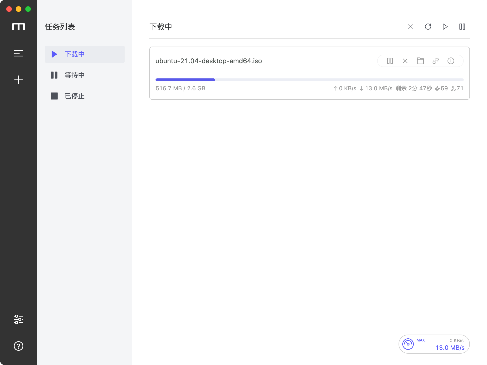

# Motr

<a href="https://shizengzhou.github.io/motr/">
  
</a>

## 使用 Tauri 重写 [Motrix v1](https://github.com/agalwood/Motrix)

[English](./README.md) | 简体中文

## 安装

[GitHub Releases](https://github.com/shizengzhou/motr/releases)

## ✨ 特性

- 🕹 简洁明了的图形操作界面
- 🦄 支持 BT 和磁力链任务
- ☑️ 支持选择性下载 BT 部分文件
- 📡 每天自动更新 Tracker 服务器列表
- 🔌 UPnP & NAT-PMP 端口映射
- 🎛 最高支持 10 个任务同时下载
- 🚀 单任务最高支持 64 线程下载
- 🚥 设置上传/下载限速
- 🕶 模拟用户代理 UA
- 🔔 下载完成后通知
- 🤖 常驻系统托盘，操作更加便捷
- 📟 系统托盘速度仪表显示实时速度 (Mac 专享)
- 🌑 深色模式
- 🗑 移除任务时可同时删除相关文件
- 🌍 国际化

## 🖥 应用界面



## ⌨️ 本地开发

### 克隆代码

```bash
git clone git@github.com:shizengzhou/motr.git
```

### 安装依赖

```bash
cd motr
pnpm install
```

### 开发模式

```bash
pnpm tauri dev
```

### 编译打包

```bash
pnpm tauri build
```

## 🛠 技术栈

- [Tauri](https://v2.tauri.app/)
- [Vue](https://vuejs.org/) + [VueX](https://vuex.vuejs.org/) + [Element](https://element.eleme.io)
- [Aria2](https://aria2.github.io/)

## 📜 开源许可

基于 [MIT license](https://opensource.org/licenses/MIT) 许可进行开源。
