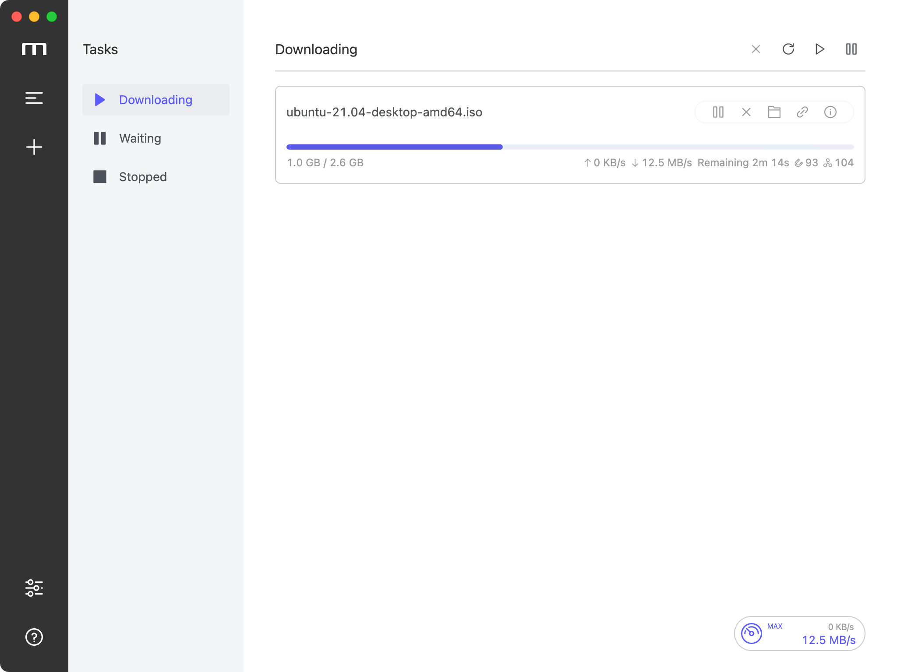

# Motr

<a href="https://shizengzhou.github.io/motr/">
  
</a>

## A Tauri rewrite of [Motrix v1](https://github.com/agalwood/Motrix)

English | [简体中文](./README-CN.md)

## Installation

[GitHub Releases](https://github.com/shizengzhou/motr/releases)

## ✨ Features

- 🕹 Simple and clear graphical user interface
- 🦄 Support BitTorrent and Magnet tasks
- ☑️ Selective downloading of files in a torrent
- 📡 Automatically update the tracker list every day
- 🔌 UPnP & NAT-PMP port mapping
- 🎛 Up to 10 tasks downloading concurrently
- 🚀 Up to 64 threads per task
- 🚥 Upload/download speed limits
- 🕶 Mock User-Agent
- 🔔 Notification when a download completes
- 🤖 Resident system tray for quicker access
- 📟 Tray speedometer with real-time speed (macOS only)
- 🌑 Dark mode
- 🗑 Delete related files when removing tasks (optional)
- 🌍 I18n

## 🖥 Screenshot



## ⌨️ Development

### Clone the repository

```bash
git clone git@github.com:shizengzhou/motr.git
```

### Install dependencies

```bash
cd motr
pnpm install
```

### Development mode

```bash
pnpm tauri dev
```

### Build and package

```bash
pnpm tauri build
```

## 🛠 Tech stack

- [Tauri](https://v2.tauri.app/)
- [Vue](https://vuejs.org/) + [VueX](https://vuex.vuejs.org/) + [Element](https://element.eleme.io)
- [Aria2](https://aria2.github.io/)

## 📜 License

Released under the [MIT license](https://opensource.org/licenses/MIT).
